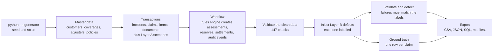

# Insurance Claims Synthetic Data Generator

A reproducible generator for a synthetic insurance claims dataset. It models the full claims
workflow (intake, policy coverage validation, document requests, eligibility assessment,
reserves and settlement routing), applies business rules from a documented rules engine,
injects **labelled** edge cases, and ships a separate **ground truth** file, a validation
report, and checksums that prove every run is identical.

## At a glance

| | |
|---|---|
| Size | 2,000 policies, 1,000 claims, 5 claim types, 14 tables plus ground truth |
| Reproducible | Fixed seed `20261022`; two separate runs give 36 of 36 byte-identical files (SHA-256) |
| Validation | 147 checks pass on the clean data; after defect injection every failing check is explained by the ground truth |
| Ground truth | One labelled row per claim (142 injected edge cases, 82 natural cases, 776 with no issue) |
| Tests | 57 automated tests |
| Formats | CSV, JSON, and a SQL seed for SQLite that loads with foreign keys enforced |
| Data origin | 100% synthetic. No external datasets, no personal data |

## Quick start

```powershell
git clone https://github.com/SaiMokshagna/Insurance-claims-synthetic-data.git
cd Insurance-claims-synthetic-data
python -m venv .venv
.venv\Scripts\Activate.ps1            # macOS / Linux: source .venv/bin/activate
pip install -r requirements.txt

python -m pytest                      # run the tests
python -m generator                   # generate everything into output/
python scripts/demo.py                # guided tour of the committed dataset in data/
python scripts/verify_manifest.py data       # check data/ against its checksums
python scripts/check_reproducibility.py      # two-run proof (about a minute)
```

Requires Python 3.11. No API keys, accounts, or environment variables are needed.

### Command-line options

| Option | Default | Meaning |
|---|---|---|
| `--seed` | `20261022` | Seed for the single random generator that drives the whole run |
| `--policies` | `2000` | Number of policies. Customers and adjusters scale with it |
| `--claims` | `1000` | Number of claims. Anomaly counts scale proportionally |
| `--out` | `output` | Output folder |
| `--verbose` | off | Print every validation check, not only failures |

The same generator produces a small starter set (for example `--policies 200 --claims 100`)
and the full set. The committed copy in `data/` was produced with
`python -m generator --out data`.

## What the dataset contains

| Table | Rows | What it holds |
|---|---|---|
| customers | 1,200 | Fictional customers with a risk tier |
| coverages | 6 | Coverage catalogue (collision, theft, property damage, medical, liability) |
| adjusters | 40 | Junior, senior and manager adjusters, each with an approval authority |
| policies | 2,000 | In-force, expired, lapsed and cancelled policies |
| policy_coverages | 3,308 | Bridge table: limit, deductible and exclusions per policy and coverage |
| incidents | 985 | Insured events (duplicate claims share an existing incident) |
| claims | 1,000 | Claims with derived totals and indicators |
| claim_items | 2,510 | Line items; the claim total is summed from them |
| documents | 3,239 | Required and optional document metadata, including outstanding requests |
| claim_assignments | 1,601 | Primary and reviewer adjusters per claim |
| assessments | 973 | Eligibility decision with a reason code and reason text |
| reserves | 1,758 | Preliminary reserve, then a released (revised) row once paid |
| settlements | 975 | Recommendation, routing, approval and payment |
| status_events | 16,718 | Audit log of every state change for policies, claims, documents and settlements |
| ground_truth | 1,000 | Labels and expected decisions (kept in its own folder) |

Every field is described in [`docs/data_dictionary.md`](docs/data_dictionary.md): type, allowed
values, uniqueness and validation rule. IDs follow the required patterns, for example
`POL-AUTO-2026-000001`, `CLM-2026-000001`, `DOC-CLM-2026-000001-001`,
`ASN-CLM-2026-000001-001`, `SET-CLM-2026-000001-001`.

## How it works



1. **Master data first, then dependent records**, always using valid parent IDs.
2. **Valid baseline first.** Claims are drawn in proportion to how many days a coverage was in force.
3. **The rules engine decides outcomes.** Random draws only decide *how long* each step takes, never *what* the outcome is.
4. **Derived values are computed from source records**: claim totals from items, reserves from limits and deductibles, claim status from the last audit event.
5. **Edge cases are injected after the baseline is validated** and are always labelled.
6. **Everything is checked, exported with checksums, and re-run twice** to prove reproducibility.

### Business rules (first match wins)

| # | Check | Decision | Reason code |
|---|---|---|---|
| 1-4 | Claim or incident outside the coverage period | INELIGIBLE | `CLAIM_BEFORE_POLICY_START`, `INCIDENT_BEFORE_POLICY_START`, `POLICY_CANCELLED_BEFORE_INCIDENT`, `INCIDENT_AFTER_COVERAGE_END` |
| 5 | Excluded peril | INELIGIBLE | `EXCLUDED_PERIL` |
| 6 | Duplicate of an earlier claim | INELIGIBLE | `DUPLICATE_CLAIM`, `DUPLICATE_INCIDENT` |
| 7 | Mandatory document outstanding for more than 30 days | INELIGIBLE | `DOCUMENTS_OVERDUE` |
| 8 | Mandatory document outstanding, within 30 days | PENDING_DOCUMENTS | `MISSING_MANDATORY_DOCUMENT` |
| 9 | Fraud score of 50 or more | REFER_INVESTIGATION | `FRAUD_REFERRAL` |
| 10 | Claimed amount does not exceed the deductible | INELIGIBLE | `BELOW_DEDUCTIBLE` |
| 11 | Payout would exceed the limit | PARTIALLY_ELIGIBLE | `COVERED_LIMIT_CAPPED` |
| 12 | Otherwise | ELIGIBLE | `COVERED_OK` |

Payout = `min(max(0, eligible - deductible), limit)`. The reserve uses the same formula.
Small payouts with a low fraud score auto-approve; others go to a senior or manager whose
approval authority covers the amount. The approver is never the claim's own adjuster.

## Anomalies and ground truth

Two layers, because "wrong" means different things:

| Layer | Issue types | How they are made | What the data shows |
|---|---|---|---|
| **A: process handles them correctly** | `DUPLICATE_CLAIM` (15), `DUPLICATE_INCIDENT` (15), `FRAUD_SUSPECTED` (30) | Built as extra **inputs** before the workflow runs | The rules engine reacts: duplicates are rejected, fraud patterns are referred |
| **B: recorded data breaks a rule** | `CLAIM_BEFORE_POLICY_START` (12), `POLICY_CANCELLED_BEFORE_INCIDENT` (12), `INCIDENT_OUTSIDE_COVERAGE` (16), `SETTLEMENT_EXCEEDS_LIMIT` (15), `MISSING_MANDATORY_DOCUMENT` (15), `CLAIM_PAID_TWICE` (12) | Surgical edits to finished records | A paid claim that should not have been paid, or a payment above the limit |
| **Natural** | `AMOUNT_OVER_LIMIT` (35), `INCOMPLETE_EVIDENCE` (47) | Arose in the baseline | Handled correctly; labelled for evaluation |

`data/ground_truth/ground_truth.csv` has one row per claim with the issue type, its origin,
the expected decision, the expected reason code and the expected payable amount. Expected
decisions are produced by the same rules engine, run on the final data. Ground truth is
**never** read by any generator step, and it is not in the table exports or the SQL seed.

## Validation and testing

* **147 checks** on the clean data: key uniqueness, ID formats, foreign keys, allowed values,
  date ordering, arithmetic reconciliation, lifecycle transitions and duplicates.
  See [`data/reports/validation_summary.md`](data/reports/validation_summary.md).
* **After defect injection** the same checks run again. Each failing check must match the
  number of injected defects exactly; any other failure is reported as a bug.
* **Detection harness.** A detector reads only the final tables and predicts one issue per
  claim; it is scored against the ground truth (precision and recall per issue type).
  Defect types use logic independent of the rules engine. The three natural types use the
  rules engine itself, so for those the score only shows that labels and rules agree.
  The harness is meant to be reused: any other model's predictions can be scored the same way.
* **SQL check.** The SQL seed loads into SQLite with foreign keys enforced, and totals
  reconcile when queried in SQL.
* **Reproducibility.** [`docs/reproducibility_report.md`](docs/reproducibility_report.md):
  two separate runs with the same seed give identical checksums; a run with a different
  seed does not.
* **Unit tests** cover every rule boundary (for example an incident on the cancellation date
  is covered, one day later is not; a document outstanding 30 days is pending, 31 is overdue).

## Design decisions and assumptions

| Decision | Reason |
|---|---|
| One seeded `numpy` generator for the whole run; the order of draws defines the dataset | Same seed gives the same data |
| Hand-written name lists instead of Faker | Faker output can change between versions, which would break reproducibility |
| Fixed reference date (2026-10-22), no system clock | Derived statuses and dates cannot drift |
| Pure-function rules engine | Easy to test, and the validator and ground truth reuse it |
| Audit log computes `from_status` itself and refuses events that go backwards in time | Event chains cannot be inconsistent |
| Validators avoid reusing generator code (independent recount, re-derivation, SQL load) | A check that trusts the code it checks proves nothing |
| CSV written with `\n` line endings, no timestamps anywhere, and `data/` marked as non-text in `.gitattributes` | Checksums stay identical on every platform |
| Pandas and SQLite only | Small, easy to run and explain; no services to set up |

Assumptions where the brief was silent: four products (AUTO, HOME, HLTH, LIAB) cover the five
claim types; currency is USD; the `2026` in IDs is the dataset year; ID counters are global per
entity; "duplicate incident" means the same policy, type and date filed as a new incident;
the reporting date for all derived values is 2026-10-22.

## Project structure

```
generator/
  __main__.py        command-line entry point
  pipeline.py        the whole pipeline in one function
  config.py          seed, reference date, parameters, anomaly plan
  reference_data.py  names, coverage catalogue, document and item rules
  ids.py             ID builders and format patterns
  master.py          customers, coverages, adjusters, policies, bridge table
  transactions.py    incidents, claims, items, documents, Layer A scenarios
  rules.py           the rules engine (pure functions)
  context.py         builds the per-claim input the rules engine reads
  workflow.py        assignments, assessments, reserves, settlements
  events.py          the audit log
  anomalies.py       Layer B defects and ground truth
  detect.py          detector and precision/recall scoring
  validate.py        all validation checks
  report.py          validation summary
  export.py          CSV, JSON, SQL, manifest
scripts/             demo, manifest verification, reproducibility proof
tests/               57 tests
docs/                data dictionary and reproducibility report
data/                the committed dataset (CSV, JSON, SQL, ground truth, reports, manifest)
```

## Provenance and lawful use

No external data is used, so no source URL, licence or retrieval date applies
(`manifest.json` records an empty `external_data` list). Nothing was scraped and no personal
information was collected. Names come from short fictional lists, email addresses use the
reserved `example.com` domain, and phone numbers use the fictional `555` range.

## Known limitations and future work

* Policies are single-term records; renewals are not modelled.
* Claims referred for investigation stay referred; investigation outcomes are not modelled.
* One currency (USD). Timestamps in the audit log use a synthetic hour of day.
* Submission dates are capped at the reference date, so a few claims are bunched on that day.
* Fraud-suspected claims are engineered to trip a documented score. Real fraud is subtler.
* Detection scores for the natural issue types are circular by construction.

Possible next steps: a pluggable scoring command for external models, SQL versions of the
validators, richer narrative text for incident descriptions, renewals and investigation
outcomes, and a small dashboard over the validation results.
